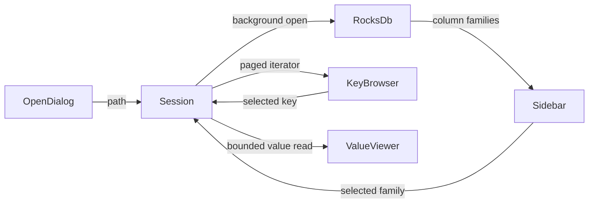

# RocksDB GUI MVP 实现计划

## 目标与边界
- 使用 GPUI + `gpui-component`，沿用 zedis 的 `App/Entity/Context/Render` 状态模型和主界面布局。
- 第一阶段只读：打开本地 RocksDB 目录，枚举 Column Families，浏览 key，查看 value。
- 所有 key/value 都按 `Vec<u8>` 处理：UTF-8 可读时显示文本，否则显示十六进制，避免二进制数据损坏。
- 不把 Redis 的 TTL、key type、层级树直接映射到 RocksDB；可以提供可选的文本前缀过滤，但数据模型仍是扁平有序 KV。

## 分阶段实现

### 1. 工程与应用骨架
- 更新 `Cargo.toml`，加入 GPUI、`gpui-component`、`rocksdb`、错误处理和日志依赖，并配置与 zedis 兼容的 GPUI git 依赖方式。
- 将 `src/main.rs` 从占位程序改为 GPUI 启动入口：初始化应用、主题、窗口、根视图和基础错误提示。
- 新增模块入口 `src/app.rs`、`src/state.rs`、`src/views/mod.rs`。

### 2. RocksDB 只读数据层
- 新增 `src/storage/mod.rs`，封装数据库访问，不让 UI 直接依赖 `rocksdb::DB`。
- 设计 `RocksDbSession` / `DbSnapshot` 等类型，保存路径、当前 Column Family、数据库元信息、加载状态和错误状态。
- 以只读模式打开数据库，并在后台线程执行所有 RocksDB 操作，避免阻塞 GPUI 主线程。
- 打开流程：选择目录 -> 检查 RocksDB 数据库 -> 枚举 Column Families -> 默认选中 `default` -> 通知 UI 更新。
- 浏览流程：使用 RocksDB iterator 按顺序读取，采用批量/分页模型，不一次性把整个数据库复制到内存；为大数据库保留“已加载数量”和“继续加载”状态。
- 查询流程：对 key 做前缀过滤，优先使用 iterator seek；明确区分“数据库没有结果”和“读取失败”。
- 对数据库句柄和异步任务增加 session/generation 校验，防止用户切换路径或 Column Family 后旧任务把结果写回当前界面。

### 3. 主界面与打开数据库
- 新增 `src/views/root.rs`，实现 zedis 风格的根布局：顶部工具栏、左侧数据库/Column Family 区域、右侧浏览器和详情面板。
- 新增 `src/views/open_database.rs`，使用 GPUI 路径选择器打开本地目录，并显示打开中、成功、失败三种状态。
- 新增 `src/views/sidebar.rs`，显示当前数据库路径、Column Family 列表、当前选择项和重新打开入口。
- 数据库未打开时显示明确的空状态；数据库打开失败时显示可复制的错误信息和重试按钮。

### 4. Key 浏览器
- 新增 `src/views/key_browser.rs`，使用虚拟列表/增量加载展示 key。
- 提供前缀搜索、清空搜索、刷新、加载更多、跳到首项等基础操作。
- 每行显示 key 的文本预览或 hex 预览；选中 key 后通过状态事件加载对应 value。
- 不默认构造 Redis 风格目录树；如果后续确认 key 命名约定稳定，再单独增加“逻辑分组”视图，而不是耦合到存储层。

### 5. Value 查看器
- 新增 `src/views/value_viewer.rs`，展示当前 key、value 大小和编码模式。
- 至少支持：UTF-8 文本、十六进制、字节长度、复制 key/value。
- 对超大 value 增加大小上限和显式“加载完整内容”动作，默认只读取预览，避免界面卡顿或内存暴涨。
- 为无法解码的内容保留原始字节展示，不做有损替换。

### 6. 状态、事件与交互规范
- 参考 `zedis/src/states/server.rs` 的事件驱动方式，但将状态缩减为 `Closed / Opening / Ready / Loading / Failed`。
- 使用单一 session entity 作为数据库读取状态源；各视图通过订阅事件刷新，并在状态改变后调用 `cx.notify()`。
- 参考 `zedis/src/views/content.rs` 的懒加载视图策略，只在数据库成功打开后创建浏览器和详情面板。
- 参考 `zedis/src/views/key_tree.rs` 的后台构建、虚拟列表、搜索输入和任务取消思路，但按 RocksDB 的有序 KV 特性实现。

### 7. 测试与验证
- 为 storage 层增加临时 RocksDB 测试：打开数据库、枚举 Column Family、写入测试 fixture 后只读读取、前缀过滤、空库和异常路径。
- 为 key/value 格式化增加 UTF-8、二进制、空字节和超大 value 测试。
- 使用 GPUI headless/test-support 方式测试关键状态转换：打开成功、打开失败、切换 Column Family、切换数据库后丢弃旧异步结果。
- 实现后运行 `cargo fmt`、`cargo check` 和 `cargo test`，再根据本机 RocksDB 数据库做一次手工验收。

## 预期首批文件
- 修改：`Cargo.toml`、`src/main.rs`
- 新增：`src/app.rs`、`src/state.rs`、`src/storage/mod.rs`
- 新增：`src/views/root.rs`、`src/views/open_database.rs`、`src/views/sidebar.rs`、`src/views/key_browser.rs`、`src/views/value_viewer.rs`

## 数据流

## 暂不纳入首阶段
- 写入、删除、批量修改、事务和 WriteBatch。
- RocksDB 事务日志、compaction、统计信息和 Column Family 管理。
- 自动识别 JSON/MessagePack/Protobuf 等业务编码。
- 远程 RocksDB、S3/对象存储、RDB/WAL 修复和跨库比较。

这些功能可以在只读路径稳定后以独立模块加入，避免第一版把 UI、存储访问和写入安全策略同时复杂化。
